# Remapping Time in AR

Real-time **time remapping** for video see-through AR on Meta Quest 3 (see [Getting started](#getting-started)). The headset buffers what its
cameras see and chooses, every frame, *which moment of the world to show you*: slow motion, freeze,
rewind, fast-forward catch-up, or time that only slows inside a virtual volume, all tunable live from a laptop.

This is the demo system accompanying the UIST '26 paper
[*Remapping Time in Augmented Reality*](https://nandi-zhang.github.io/static/media/uist-26-remapping-time.e45be34afbda688b1d12.pdf)
(Nandi Zhang and Yukang Yan, University of Rochester). Compared to the implementation in the paper, it adds head reprojection, smoother visuals, a
policy framework for building your own effects, an in-headset tuner, and a browser-based control panel.

---

## The model explained

The system tracks and updates the temporal offset **δ(t)**: how many seconds the displayed world lags
behind reality (or ahead of reality when it's < 0). It evolves as

```
dδ/dt = u(t) − α(t)·δ(t)        displayed time  s(t) = t − δ(t)        playback rate  r = 1 − u + α·δ
```

**u** (injection) adds delay; **α** (recovery) pulls it back to zero. `u = 0.8, α ≈ 0` gives 5× slow motion,
`u = 1` freezes, `u > 1` rewinds, and a large α after a slowdown fast-forwards back to live. Constant u and α
only settle into a constant lag (δ → u/α, r → 1), so interesting effects come from **switching u and α in
response to events**. That is what a *policy* does.

---

## Features

Recorded through the headset. Click a clip for the full-quality video.

<table>
<tr>
<td width="33%" valign="top"><a href="Media/hold_to_slow.mp4">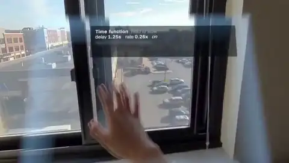</a><br><b>Hold to slow</b><br><sub>Hold the right trigger and the world plays 5× slower. Release it and the world fast-forwards back to the present.</sub></td>
<td width="33%" valign="top"><a href="Media/echo_trail.mp4">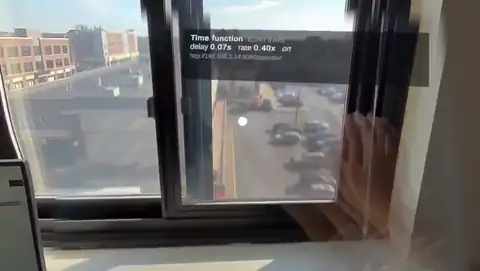</a><br><b>Echo trails</b><br><sub>Hold to slow, with earlier moments trailing behind moving things, like chronophotography.</sub></td>
<td width="33%" valign="top"><a href="Media/ghost.mp4">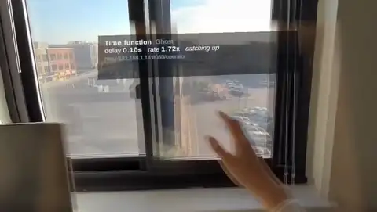</a><br><b>Ghost</b><br><sub>The slowed world appears as a translucent ghost over the live one.</sub></td>
</tr>
<tr>
<td width="33%" valign="top"><a href="Media/hand_anchored_lens.mp4">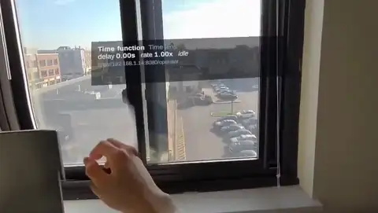</a><br><b>Time lens</b><br><sub>Only a circle around your hand is slowed. The rest of the world stays live.</sub></td>
<td width="33%" valign="top"><a href="Media/freeze.mp4">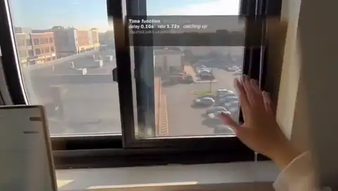</a><br><b>Freeze frame</b><br><sub>Hold to stop the world (u = 1). Release it and the world catches up.</sub></td>
<td width="33%" valign="top"><a href="Media/bullet_time.mp4">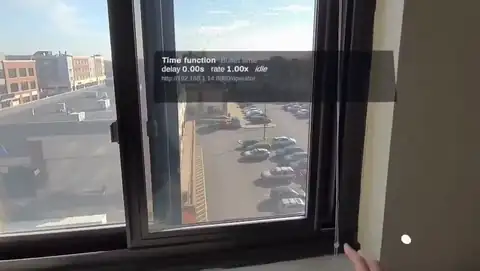</a><br><b>Bullet time</b><br><sub>Almost frozen (12× slower) while held, then a long, dramatic fast-forward.</sub></td>
</tr>
<tr>
<td width="33%" valign="top"><a href="Media/motion_slowmo.mp4">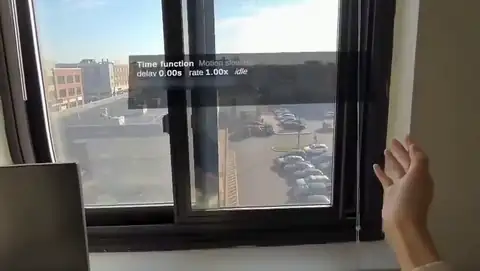</a><br><b>Motion slow-mo</b><br><sub>No button: a fast hand movement slows the world, which recovers when you stop.</sub></td>
<td width="33%" valign="top"><a href="Media/outrun_yourself.mp4">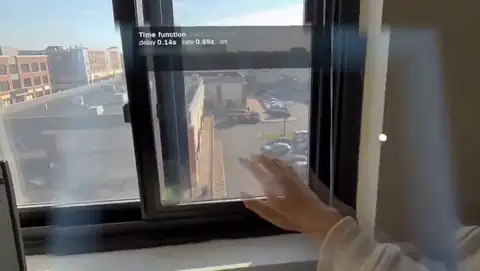</a><br><b>Outrun yourself</b><br><sub>The faster your hand moves, the slower its image, so your hand leaves its image behind.</sub></td>
<td width="33%" valign="top"><a href="Media/time_wobble.mp4">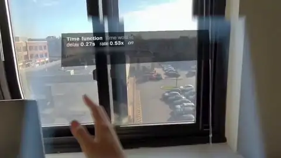</a><br><b>Time wobble</b><br><sub>Always on: time breathes slower and faster, one breath every 2 s.</sub></td>
</tr>
<tr>
<td width="33%" valign="top"><a href="Media/stutter.mp4">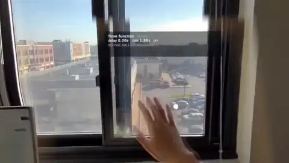</a><br><b>Stutter</b><br><sub>Always on: brief freezes on a beat, like a skipping video.</sub></td>
<td width="33%" valign="top"><a href="Media/water.mp4">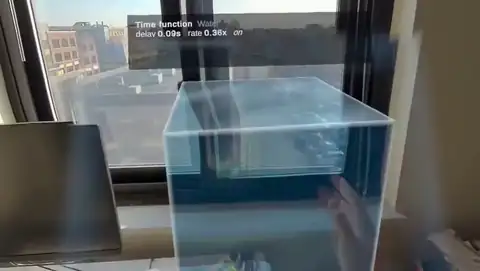</a><br><b>Water</b><br><sub>Time slows inside a block of virtual water, the deeper your hand, the slower: a pseudo-haptic thick material.</sub></td>
<td width="33%" valign="top"><a href="Media/honey.mp4">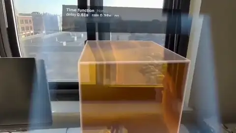</a><br><b>Honey</b><br><sub>Thicker still: deep, slow and slow to let go.</sub></td>
</tr>
<tr>
<td width="33%" valign="top"><a href="Media/gallery.mp4">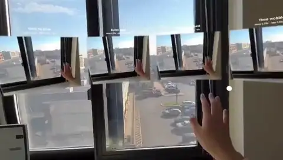</a><br><b>Timeline gallery</b><br><sub>Several presets side by side, all fed by the same camera and reacting to the same input.</sub></td>
<td width="33%" valign="top"><a href="Media/depth_reprojection.mp4">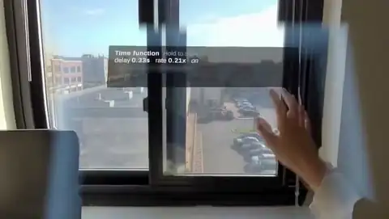</a><br><b>Depth reprojection</b><br><sub>Past frames are bent to the measured scene depth, so near and far things stay put as you move (experimental; see <a href="#head-reprojection">Head reprojection</a>).</sub></td>
<td width="33%" valign="top"><a href="Media/menu.mp4">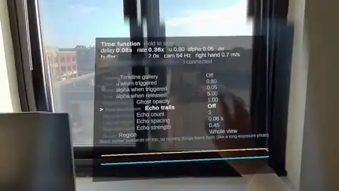</a><br><b>In-headset tuner</b><br><sub>The left thumbstick tunes any parameter, with a live graph of the delay δ and the playback rate r.</sub></td>
</tr>
</table>

Each of these is just three formulas (when, u and α) that you can retype live from a laptop: see
[Designing u(t) and α(t)](#designing-ut-and-αt) and [Web control](#web-control).

---

## Getting started

### Headsets

The system buffers raw camera frames, so it needs Meta's **Passthrough Camera API**, which only some headsets offer.

| Headset | Status |
|---|---|
| **Meta Quest 3** | Supported. Developed and tested on it. |
| **Meta Quest 3S** | Should work (it supports the Passthrough Camera API and the Depth API) but is untested. |
| Meta Quest Pro, Quest 2 | **Not supported.** The Passthrough Camera API is not available on them. |

The headset needs **Horizon OS v74 or later** and **Developer Mode** to install the app: in the Meta Horizon phone app,
open *Devices → (your headset) → Headset settings → Developer Mode*. This requires a free Meta developer account.

### Option A: install the prebuilt APK (no Unity needed)

1. Download `RemappingTime.apk` from the [latest release](https://github.com/nandi-zhang/RemappingTimeAR/releases/latest).
2. Connect the headset to your computer by USB and accept the "Allow USB debugging" prompt inside it.
3. Install the APK with one of these:
   - [Meta Quest Developer Hub](https://developers.meta.com/horizon/documentation/unity/ts-odh/): drag the APK
     onto the device panel.
   - [adb](https://developer.android.com/tools/releases/platform-tools): `adb install -r RemappingTime.apk`.
4. Continue with [First run](#first-run).

### Option B: build from source

#### Unity setup

| | |
|---|---|
| Unity | **6000.0.61f1** (Unity 6 LTS). Other 6000.0.x versions will probably work but are untested. |
| Unity modules | **Android Build Support**, including *OpenJDK* and *Android SDK & NDK Tools* (tick them when installing the editor in Unity Hub) |
| Packages | Installed automatically from [`Packages/manifest.json`](Packages/manifest.json) when the project opens: **Meta MR Utility Kit 83.0.3** (which brings in the Meta XR Core SDK), **XR Plugin Management 4.5.3** and **Oculus XR Plugin 4.5.2** |
| Render pipeline | Built-in, linear colour space, ARM64, Android API level 32 (already set in the project) |

#### Build and install

1. Clone the repository and open the folder in Unity Hub (*Add → Add project from disk*) with Unity 6000.0.61f1.
   The first import downloads the packages and takes a few minutes.
2. Switch the platform to Android: *File → Build Profiles → Android → Switch Platform*.
3. If *Meta XR → Project Setup Tool* lists issues, click *Fix All*.
4. Optional: *Remapping Time → Create Demo Scene* regenerates `Assets/RemappingTime/Scenes/RemappingTimeDemo.unity`.
   The scene is included in the repository, and *Build APK* rebuilds it automatically if it is out of date.
5. Connect the headset by USB, accept the "Allow USB debugging" prompt inside it, then either
   - choose *Remapping Time → Build APK* and run `adb install -r Builds/RemappingTime.apk`, or
   - use *File → Build And Run*.

   [Meta Quest Developer Hub](https://developers.meta.com/horizon/documentation/unity/ts-odh/) can install APKs too.

Batch-mode equivalents (useful for CI):

```
Unity -batchmode -projectPath . -buildTarget Android -executeMethod RemappingTime.EditorTools.DemoSceneBuilder.BuildFromCommandLine
Unity -batchmode -projectPath . -buildTarget Android -executeMethod RemappingTime.EditorTools.DemoBuild.BuildFromCommandLine
```

### First run

1. On the headset, open *Library → Unknown sources → Remapping Time*.
2. Allow the **camera** permission (needed) and the **spatial data** permission (needed only for depth reprojection).
3. Put the headset, and the laptop or phone you want to control it from, on the same Wi-Fi network.
4. The HUD shows the control address, e.g. `http://192.168.1.23:8080/`. Open `…/operator` on a laptop for the
   full control panel, or the plain address on a phone for a simple hold button.
5. Try *Hold to slow*: hold the right index trigger (or Space on the web page) to slow the world, then release it
   and the world fast-forwards back to the present. Then work through the other presets on the operator page.

---

## Controls

> **The right index trigger starts the remapping.** Hold it to slow (or freeze, or rewind) the world; release it
> and the world fast-forwards back to the present. This is how most presets work. A few presets start on their own instead:
> *Motion slow-mo* reacts to fast hand motion, *Water* and *Honey* to a hand inside the volume, and *Time wobble* and
> *Constant u, α* are always on. The HUD's yellow **start:** line always tells you what starts the current preset.

**Right controller: time**

| Input | Action |
|---|---|
| **Index trigger** (front, index finger): hold | **Start the remapping**; release to return to the present. Squeezing harder matters only in *Hold to slow (analog)*. |
| A | **Tap**: a one-off event (`tap`), e.g. a manual freeze in *Hitstop punch* |
| B | Snap back to the present (a very quick catch-up, about 0.2 s) |
| Grip button (side, middle finger): hold | *Water / Honey only:* carry the water block to your right hand |

Hand tracking works too. Motion presets read the speed of **both hands**: whichever index fingertip (or controller,
if held) is moving fastest *inside the cameras' view* counts. Motion outside the view is ignored, since the remapping
could not be seen there.

**Left controller: status HUD and tuner**

| Input | Action |
|---|---|
| Y | HUD: minimal (default) → hidden → full |
| Thumbstick ↑/↓ | Select a setting (sliders, self-defined variables, effects, display, …) |
| Thumbstick ←/→ | Change value (hold to accelerate) |
| Thumbstick click | Reset to default |
| X | Next main preset |
| Grip button (side, middle finger): hold | **Bypass**: show the present (live) while held, for a before/after comparison |

**Without a controller in hand:** hold **Space** on the operator page (or the big button on the phone page) instead of
the trigger. In the Editor (play mode over Link): Space = hold, Enter = tap, Backspace = back to the present.

## Web control

The headset runs a small HTTP + WebSocket server on port **8080** (no internet, no app install).

- `http://<headset-ip>:8080/operator` **operator** (laptop): pick presets, **type the formulas for u(t) and α(t)**,
  tune knobs and effects, save presets, and watch δ(t), r(t), u(t) live. On a shared network you can set an
  **operator PIN** on the *Remote Control Bridge* component.
- `http://<headset-ip>:8080/` **remote** (phone): shows only the controls the current formulas use. That is a hold
  button if they read `hold`, and a Tap button for `tap`.

**No phone?** A laptop works for everything: hold **Space** (on either page) to hold, **P** = tap, **L** = back to the present.

**If the page doesn't load:** some networks (campus, office, public Wi-Fi) block devices from reaching each other.
Use a home router or a phone hotspot for both the headset and the laptop. Web inputs time out after 0.6 s, so a
dropped connection never leaves the wearer stuck in slow motion.

The protocol is documented in [`Docs/PROTOCOL.md`](Docs/PROTOCOL.md) if you want to drive the system from your own
code (Python, TouchDesigner, a game server, …).

---

## Designing u(t) and α(t)

On the operator page, **Time remapping** shows three sliders that cover most designs: **u when triggered**,
**α when triggered** and **α when released**. What "triggered" means (holding the trigger, moving fast, touching the
water, …) comes from the preset. Behind them, everything is described by three formulas, editable under **Advanced**,
where the sliders appear as `uon`, `aon` and `aoff`:

| Formula | Meaning | Example |
|---|---|---|
| **when** | trigger condition; while true `on` = 1 and `ton` counts up, afterwards `toff` counts up | `hold`, `speed > 0.9`, `inzone` |
| **u =** | injection: 0 = real time, 0.8 = 5× slower, 1 = freeze, > 1 = rewind | `on ? uon : 0` |
| **α =** | recovery: pulls the delay back; catch-up takes ≈ 3/α s | `on ? aon : aoff` |

**Variables:** `t` time · `d` current delay δ · `B` buffer budget · `hold` 0–1 · `speed` fastest hand in
view (m/s) · `lspeed`, `rspeed` per hand · `depth` how deep a hand is in the water (m) · `inzone` · `on` · `ton` · `toff`
· `tap` seconds since the last Tap (A) · `uon aon aoff` the three sliders · `k1 k2 k3` **self-defined variables** (0–10,
for any extra number a formula needs; each preset names its own, and they get sliders only when a formula uses them).

**Language:** `+ − * / % ^`, comparisons, `&& || !`, `c ? a : b`, `pi`, and `sin cos tan abs sqrt exp log floor ceil
round sign sat min max pow step clamp lerp smoothstep noise`. A value counts as true when it is above 0.5.
Sliders that no formula uses are hidden.

**Drawn shapes** (under Advanced): **u(t)**, drawn over seconds since triggered, and **α(t)**, drawn over seconds since
released. Drag points, double-click to add or remove; a "now" line shows where the effect is while it runs, and *Use this
shape* switches the formula over to it. In formulas they are `c1(x)` and `c2(x)`, e.g. *Draw your own*:
u = `on ? c1(ton) : 0`, α = `on ? aon : c2(toff)`. Shapes are saved with presets.

Presets come in two lists. The **main presets** are the most representative designs and only use the three sliders:

| Preset | Start | when | u = | α = |
|---|---|---|---|---|
| Live | never | `0` | `0` | `aoff` |
| Hold to slow | right trigger | `hold` | `on ? uon : 0` | `on ? aon : aoff` |
| Echo trails · Time lens · Ghost | right trigger | `hold` | `on ? uon : 0` | `on ? aon : aoff` (with a different representation) |
| Motion slow-mo | fast hand | `speed > 0.6` | `on \|\| toff < 0.15 ? uon : 0` | `on \|\| toff < 0.15 ? aon : aoff` |
| Time wobble | always on | `1` | `max(0, uon + 0.6 * sin(pi * t))` | `aon` |
| Constant u, α | always on | `1` | `uon` | `aon` |
| Water / Honey | hand in the water | `inzone` | `on ? uon * sat(depth / 0.03) : 0` | `on ? aon : aoff` |

**Advanced presets** are more specialised, and most add self-defined variables to tune:

| Preset | Start | when | u = | α = |
|---|---|---|---|---|
| Hold to slow (analog) | right trigger | `hold > 0.05` | `on ? uon * hold : 0` | `on ? aon : aoff` |
| Bullet time · Freeze frame · Rewind while held | right trigger | `hold` | `on ? uon : 0` | `on ? aon : aoff` (u = 0.92, 1, 2) |
| Gradual brake | right trigger | `hold` | `on ? uon * smoothstep(0, k1, ton) : 0` | `on ? aon : aoff` |
| Outrun yourself | fast hand | `speed > k1` | `on ? min(0.95, k2 * (speed - k1)) : 0` | `on ? aon : aoff` |
| Hitstop punch | fast hand or A | `speed > k1 \|\| tap < 0.3 \|\| (on && ton < k2)` | `on ? uon : 0` | `on ? aon : aoff` |
| Draw your own | right trigger | `hold` | `on ? c1(ton) : 0` | `on ? aon : c2(toff)` |
| Looping shape | always on | `1` | `c1(t % k1)` | `c1(t % k1) > 0.5 ? aon : aoff` |
| Stutter | always on | `1` | `uon * step(0.7, sin(2 * pi * k1 * t))` | `aon` |
| Drifting time | always on | `1` | `uon * noise(k1 * t)` | `aon` |

The headset's X button steps through the main presets; the operator page lists both. Presets saved from the operator page live in
`/sdcard/Android/data/org.remappingtime.demo/files/remapping_presets.json`.

---

## Head reprojection

Every buffered frame is stored with the pose of the camera that captured it, **H_cap**. By the time the frame is
shown, the head has usually moved to **H_now**. *Display → Head reprojection* decides where the frame is drawn.

**How to read the figures.** The left side is a top view: the grey dashed head is H_cap and the dark head is H_now.
The thin grey lines are the camera rays that recorded three points at different depths: a hand (0.5 m), a cup (1 m)
and a wall (2.6 m). The right side shows the direction in which the wearer sees each point. A hollow circle is
where the point really is (the live passthrough), a filled dot is where the remapped frame shows it, and the
number is the angle between them. **K** is the camera intrinsics, so K⁻¹[u v 1]ᵀ is the ray through pixel (u, v).
Each loop turns the head, then moves it sideways, then does both.

### Off

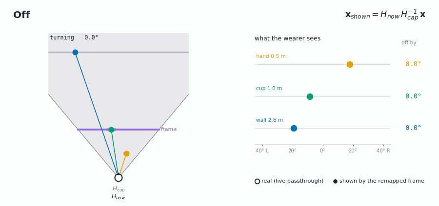

The frame is pinned to the head: every point keeps the camera coordinates it had at capture time and is shown
relative to the *current* head, x_shown = H_now H_cap⁻¹ x. Everything is misaligned as soon as the head moves, so
this only suits viewing with a still head.

### Flat plane (default)

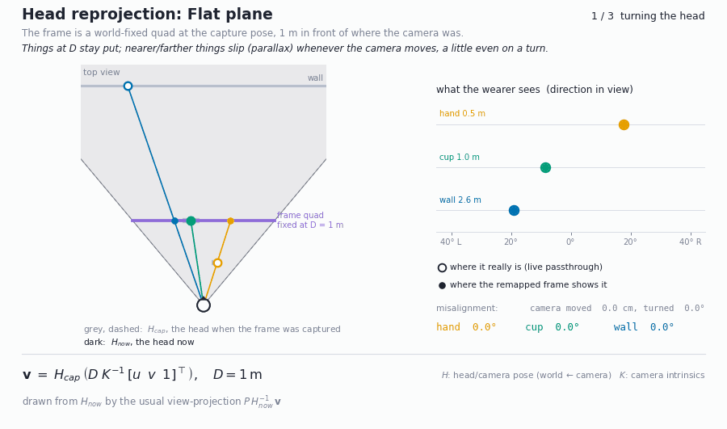

The frame is a quad fixed in the world at the capture pose, D = 1 m in front of where the camera was. Each vertex
is v = H_cap (D K⁻¹[u v 1]ᵀ), and the quad is then rendered from the current head like any other object. Points at
distance D stay put. Nearer and farther points slip by parallax, roughly in proportion to
camera movement × |1/D − 1/depth|. A pure head turn causes a little parallax too, because the cameras sit about
9 cm in front of the neck's pivot. D is fixed at 1 m (presets for close-up work, such as the water, use 0.6 m). In
practice the difference was hard to perceive, so D is not exposed in the UIs.

### Depth (experimental)

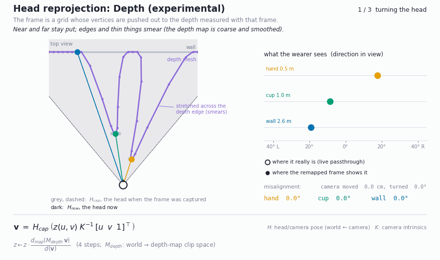

On the headset:

<a href="Media/depth_reprojection.mp4"></a>

Each frame also stores the depth map from Meta's Depth API, with M_depth, the matrix from world space to the depth
map. The frame is drawn as a 48 × 36 grid, and the vertex shader moves every vertex along its camera ray to the
measured depth: v = H_cap (z(u, v) K⁻¹[u v 1]ᵀ). It finds z in four fixed-point steps,
z ← z · d_map(M_depth v) / d(v): the depth stored in the map, divided by the depth of the current point, both seen
from the depth camera. Near and far things then stay put.

Limitations:

- The depth map is low resolution and smoothed, so the grid stretches across depth edges (a hand in front of a
  wall), and thin or fine details break up.
- Fast-moving objects lag in the depth sensor.
- Where there is no depth, the flat plane is used.

Depth mode requires the *spatial data* permission. The operator page's Diagnostics card shows
`depth: … frames with depth N%`.

The planar-only version of the project is tagged `v0.1-planar-reprojection` in git. The figures come from a
simplified 2D model (one camera, 9 cm in front of the neck pivot). Regenerate them with
`python Docs/figures/make_reprojection_gifs.py Docs/figures`.

---

## Architecture

```
PassthroughCameraAccess ×2 ──► StereoPassthroughCapture ──► FrameRingBuffer  (texture + camera pose per frame)
                                         │                        ▲
                                    CameraClock (t)               │ sample s(t), blend, pose
                                         ▼                        │
 InputHub (controllers + web) ─┐   TimeRemapEngine ──► RemapChannel (δ, s, r) ──► ReprojectedFrameView ─► eyes
 TrackedPoint (hand/controller)┼─►  RemapContext  ──► RemapPolicy → (u, α)        TimelineGallery (more channels)
 ZoneVolume (depth) ───────────┘         │
                                Tunables / Presets ◄──► HeadsetHud (left controller)
                                                    ◄──► RemoteControlBridge ◄─ WebSocket ─► browser pages
```

| Folder | Contents |
|---|---|
| `Runtime/Core` | `RemapDynamics` (the ODE and helpers), `FrameRingBuffer`, `CameraClock`, `RemapChannel`, `Tunable`, `PresetLibrary` |
| `Runtime/Capture` | Stereo camera capture with per-frame poses |
| `Runtime/Signals` | Tracked hand/controller kinematics, input merging |
| `Runtime/Policies` | `FunctionPolicy` (formula-driven u, α), the policy base class and `PolicyCatalog` |
| `Runtime/Rendering` | Reprojected view, frame quads, gallery, zone, per-eye layer setup |
| `Runtime/UI` | In-headset HUD |
| `Runtime/Remote` | Minimal HTTP/WebSocket server, protocol, engine bridge |
| `Shaders` | Frame compositing (blend, feather, lens, cues), unlit UI, zone volume |
| `Resources/RemappingTime` | `remote.html`, `operator.html` (served from the headset) |
| `Editor` | Scene builder, APK build, web UI smoke test |

### Writing a policy in code

Most designs fit in the three formulas. When you need something they can't express (another sensor, networking, game
state), write a policy class. It appears as a choice on the operator page, and its knobs show up in the HUD and web UI.

```csharp
using RemappingTime;
using UnityEngine;

// Time slows while a hand is raised above the head.
public sealed class RaiseHandPolicy : RemapPolicy
{
    public override string Id => "raise";
    public override string DisplayName => "Raise hand to slow";
    public override string Description => "Lift your hand above your head to slow the world.";

    private readonly Tunable _u, _catchUp;

    public RaiseHandPolicy()
    {
        _u = Range("u", "Slowdown u", 0f, 1f, 0.75f, 0.05f);           // shows up in the HUD and web UI
        _catchUp = Range("alpha", "Catch-up α", 0f, 20f, 5f, 0.1f);
    }

    public override RemapCommand Evaluate(in RemapContext ctx)
    {
        bool raised = ctx.Motion.Tracked && ctx.Motion.Position.y > ctx.Head.position.y + 0.1f;
        return raised ? new RemapCommand(_u.Value, 0.05f, "raised")
                      : new RemapCommand(0f, _catchUp.Value, ctx.Delay > 0.01 ? "catching up" : "idle");
    }
}

// Register once at startup, before the engine's Awake:
// [RuntimeInitializeOnLoadMethod(RuntimeInitializeLoadType.BeforeSceneLoad)]
// static void Register() => PolicyCatalog.Register(() => new RaiseHandPolicy());
```

### Building a game or study on top

Drive everything through `TimeRemapEngine`: `ApplyPreset`, `SetExpression("u", "...", out err)`, `SetTunable`,
`Inputs.QueueAction()` (the Tap), and read `Main.Delay`, `Main.Rate`, `Main.Phase`. For example, a *spot-the-warp*
round could set when = `noise(t) > 0.8`, log when `Main.Phase == "on"`, and score the wearer's trigger presses against it.

---

## Tips

- **Safety:** while time is remapped you are not seeing the present. Stand or sit still, and don't walk while slowed.
- **Power and heat:** two cameras at 60 Hz plus a 1.2 GB frame buffer is a heavy load, so expect the battery to drain
  quickly and the headset to get warm. If it throttles, lower *Buffer seconds* or *Storage scale* on
  `StereoPassthroughCapture`.
- **Lighting:** hand tracking needs decent light. For fast motions (*Hitstop punch*), the right controller is more
  reliable than a bare hand.
- **Reset:** B snaps back to the present, as does *Back to present* on the operator page. Re-centre with the Meta button.
- **Before and after:** hold the left grip (*Bypass*) to compare with the live view.

## Known limitations

- Depth reprojection follows a low-resolution, smoothed depth map: depth edges stretch a little and fast motion lags.
- The buffer only holds the past, so δ ≥ 0. **Coming soon:** forward sampling (showing predicted future frames,
  paper Sec. 6.2), which we implemented for the paper and will add here.
- The remapped canvas covers the cameras' field of view, which is slightly smaller than the display's. Feathering hides the edge, but it is there.
- Hand tracking can lose very fast motion; controllers are more reliable for impact effects.

## Citation

```bibtex
@inproceedings{zhang2026remapping,
  title     = {Remapping Time in Augmented Reality},
  author    = {Zhang, Nandi and Yan, Yukang},
  booktitle = {Proceedings of the 39th Annual ACM Symposium on User Interface Software and Technology (UIST '26)},
  year      = {2026},
  doi       = {10.1145/3830398.3830686}
}
```

## License

The code in this repository is released under the [MIT License](LICENSE). The Meta XR SDK packages it depends on
(pulled in by the Unity Package Manager) are covered by the Meta Platform Technologies SDK license, and TextMesh Pro's
Liberation Sans font by the SIL Open Font License.
